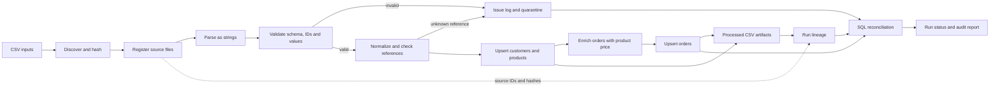

# Architecture

## Flow and guarantees

Each discovered file is hashed and registered before parsing. Required missing files receive `MISSING` records; malformed files receive `FAILED` records. Valid rows retain `source_file_id`, `source_record_number`, and original raw JSON until validation and reference checks finish. Reject artifacts are issue-grain; run metrics count distinct rejected source rows.

SQLite loading converts pandas and NumPy values to native Python scalars. New databases enforce INTEGER quantity and REAL price/amount storage. Reconciliation checks numeric storage classes, per-order SQL totals, output hashes and keys, record counts, foreign keys, and same-run lineage links. `output_artifacts` stores each output once; `data_lineage` and `transformation_inputs` express dependencies.

Business keys are deterministic from the input generator; each execution uses a fresh UUID `run_id`. Timestamps are UTC ISO-8601. See the [data dictionary](data_dictionary.md) for field definitions and provenance columns.

## Limits

The three business-table loads use separate transactions. A failure after one load can leave earlier tables published. Retry by replaying the full input snapshot; upserts prevent duplicate business keys, but an older snapshot can overwrite newer values. Cross-table atomic publication and event-time conflict protection are not implemented.
